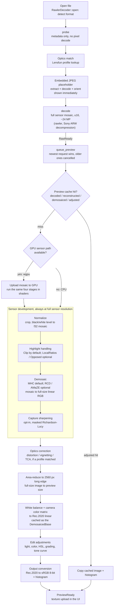

# Rohditor

Rohditor is a Linux-first Rust RAW photo editor.
It provides a deterministic CPU development pipeline, optional GPU previews,
and a desktop editor plus headless CLI.

This is an ongoing project with many features still missing.

## Build and test

```console
cargo build --workspace
./scripts/check.sh
cargo bench -p rohditor-core --bench pipeline_stages
```

The private camera corpus is intentionally not checked in. Opt-in validation:

```console
cargo test --release --workspace --tests -- --ignored --nocapture
cargo test --release -p rohditor-gpu -- --ignored --nocapture
```

## Run

```console
cargo run --release -p rohditor-desktop
cargo run -p rohditor-cli -- inspect path/to/file.ARW
cargo run --release -p rohditor-cli -- develop input.ARW output.png
```

The desktop supports `--processor auto|gpu|cpu`, `--renderer auto|wgpu|glow`,
and an optional input path. The CLI also supports embedded-preview extraction,
quality-crop generation, and LibRaw verification.

Project guidelines live in [AGENTS.md](AGENTS.md); the implementation checklist is below.

## What happens when a RAW is opened

Opening a file runs on the desktop's background worker thread
(`apps/desktop/src/coordinator/worker.rs`). The UI shows the embedded JPEG first
and replaces it once the developed preview arrives. The steps up to `decode`
run one after another.



Everything left of "Area-reduce" runs on the full ~24 MP sensor, not on the
2560 px preview, so a first open pays for normalize, highlight, demosaic, and
optics at full size. Once the base is cached, slider edits only re-run the
steps from "Edit adjustments" onwards on the small image.

The cache is layered (`apps/desktop/src/preview_cache/`) so an edit re-runs only
what its recipe fields invalidate: changing exposure keeps the demosaiced base;
changing the highlight method or demosaic algorithm rebuilds from the decoded
mosaic.

## License

Rohditor is licensed under the GNU General Public License, version 3 or (at your option) any later version. See [LICENSE](LICENSE).
